# IoT Monitoring dan Kontrol: REST API Node-RED

Repositori ini berisi hasil Praktikum 9, yaitu pembuatan sistem monitoring dan kontrol IoT berbasis MQTT. Data suhu dan kelembaban dikirim oleh simulator ESP32, Node-RED berperan sebagai backend REST API, dan data ditampilkan pada dashboard web yang dibuat menggunakan HTML, CSS, dan JavaScript.

## Gambaran Sistem

Simulator ESP32 (Python) mengirim data sensor melalui MQTT ke Node-RED. Di Node-RED, data disimpan ke database SQLite, kemudian disediakan melalui REST API dan WebSocket agar dapat ditampilkan pada dashboard.

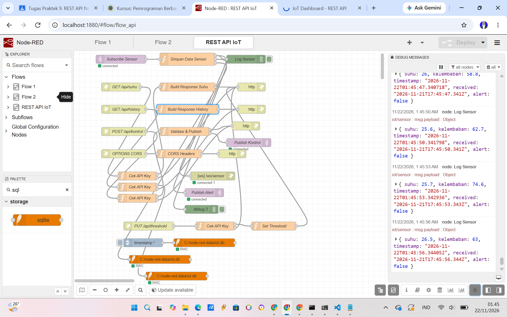
*Seluruh alur di Node-RED, mulai dari subscribe MQTT, endpoint REST, pengecekan API key, WebSocket, threshold, alert, hingga penyimpanan ke SQLite.*

---

## Praktikum Dasar (Bagian A-E)

Bagian ini merupakan hasil pengerjaan modul dasar sebelum tugas pengembangan.

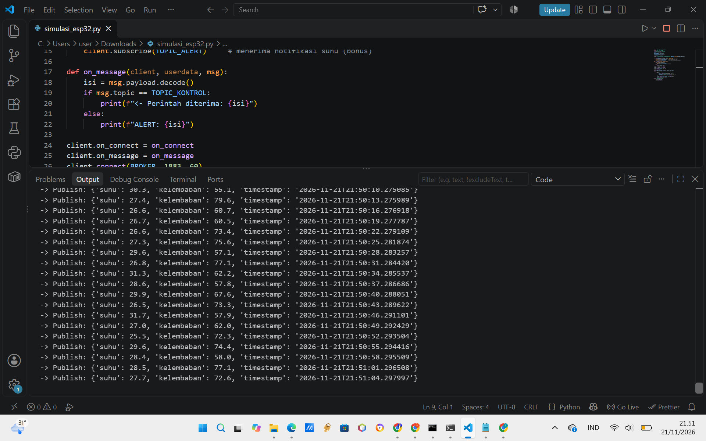
*Simulator ESP32 yang dibuat dengan Python. Simulator mengirim data suhu dan kelembaban ke topic `iot/sensor` setiap 3 detik.*

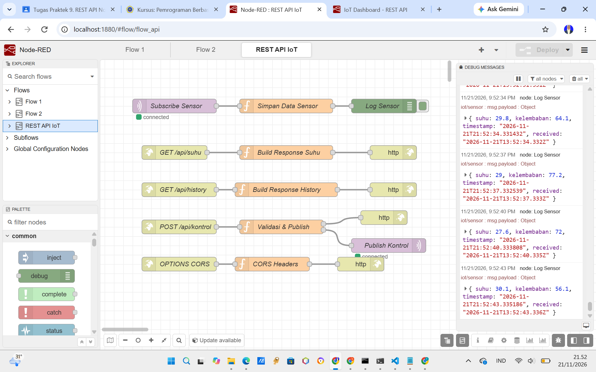
*Flow dasar di Node-RED. Node `Subscribe Sensor` berstatus connected, dan panel Debug menampilkan data sensor yang berhasil diterima dari MQTT.*

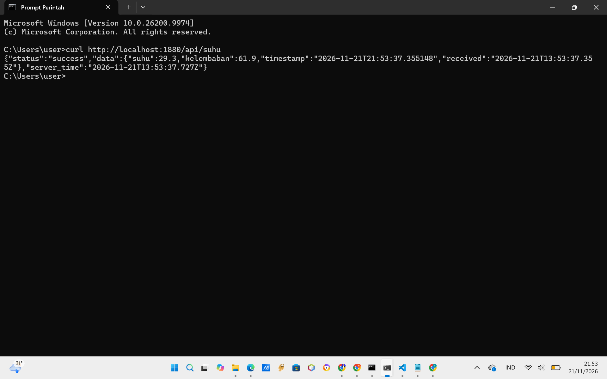
*Pengujian endpoint `GET /api/suhu` menggunakan curl. Server berhasil mengembalikan JSON yang berisi suhu, kelembaban, dan waktu.*

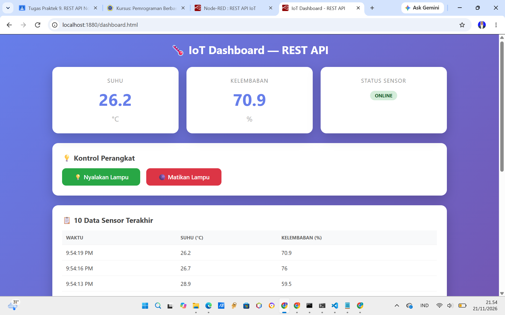
*Tampilan dashboard dasar yang memuat kartu suhu, kelembaban, status sensor (ONLINE), tombol kontrol lampu, dan tabel history.*

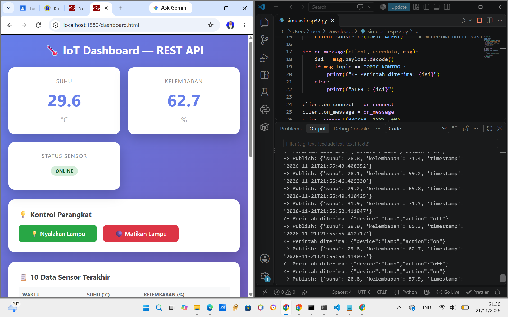
*Tombol pada dashboard mengirim `POST /api/kontrol`, lalu perintah dipublikasikan ke MQTT. Pada bagian kanan terlihat simulator menerima perintah `lamp on/off`.*

---

## Tugas Pengembangan

### 1. Endpoint `/api/threshold` (PUT) dan Notifikasi

**Penjelasan:** Threshold adalah batas suhu maksimum yang dianggap aman. Batas ini dapat diatur melalui endpoint dengan metode `PUT`. Setiap data sensor yang masuk dibandingkan dengan batas tersebut. Jika suhu melewati batas, sistem mengirim notifikasi ke topic MQTT `iot/alert` dan data ditandai dengan `alert: true`.

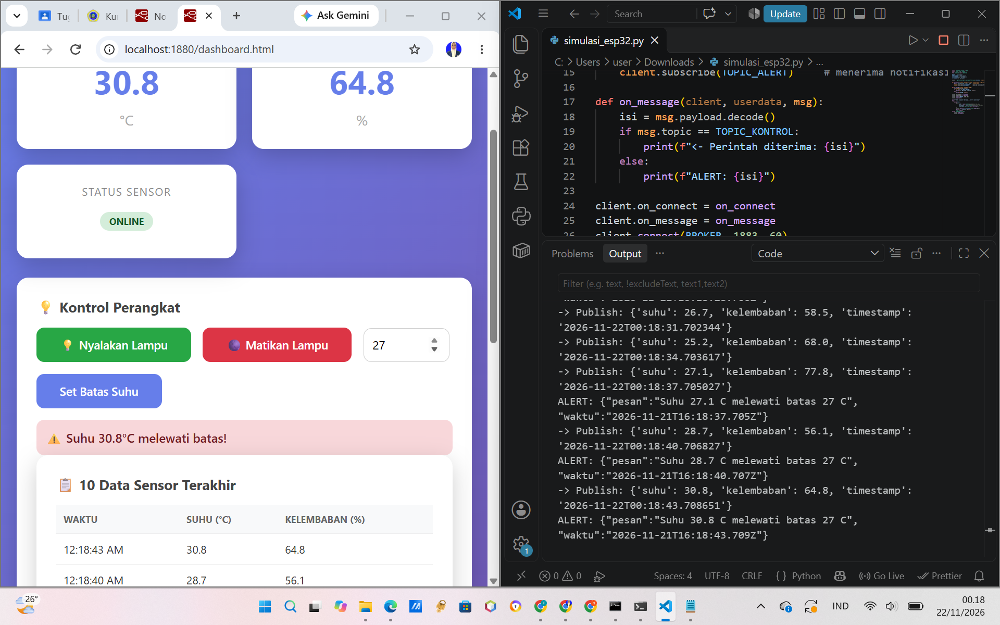
*Batas suhu diatur melalui tombol "Set Batas Suhu". Pada contoh ini suhu 30.8°C melewati batas 27°C sehingga dashboard menampilkan banner peringatan. Pada terminal simulator (sebelah kanan) juga muncul `ALERT` yang diterima dari topic `iot/alert`.*

*Alur `PUT /api/threshold` → `Cek API Key` → `Set Threshold`. Notifikasi dikirim melalui node `Publish Alert` ke MQTT.*

### 2. Grafik Real-Time dengan Chart.js

**Penjelasan:** Chart.js adalah library JavaScript untuk membuat grafik pada halaman web. Grafik di dashboard menampilkan perubahan suhu dan kelembaban dari waktu ke waktu serta bertambah otomatis setiap ada data baru, sehingga tren data lebih mudah diamati dibandingkan hanya melihat angka.

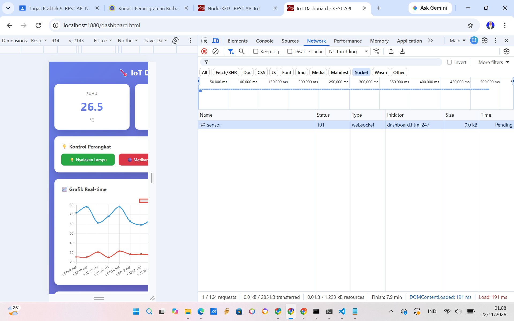
*Grafik real-time pada dashboard. Garis biru menunjukkan kelembaban dan garis merah menunjukkan suhu, dengan sumbu waktu yang terus bertambah.*

### 3. Autentikasi API Key (`X-API-Key`)

**Penjelasan:** API key adalah kunci sederhana yang harus dikirim melalui header `X-API-Key` pada setiap request. Node-RED memeriksa kunci tersebut. Jika benar, request diproses. Jika salah atau tidak disertakan, server menolak dengan status `401 Unauthorized`. Dengan demikian, pihak yang tidak berwenang tidak dapat mengakses data maupun mengontrol perangkat.

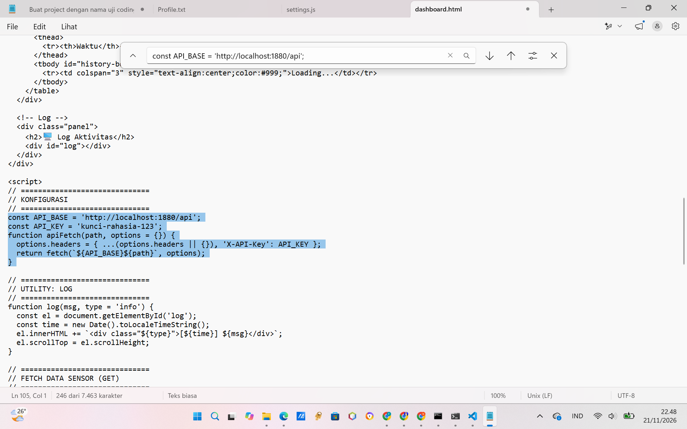
*Pada sisi dashboard dibuat fungsi `apiFetch` yang secara otomatis menambahkan header `X-API-Key` pada setiap request ke API.*

*Pada Node-RED, node `Cek API Key` dipasang sebelum setiap endpoint. Output 1 meneruskan request yang valid, sedangkan output 2 mengirim respons penolakan.*

### 4. WebSocket untuk Update Tanpa Polling

**Penjelasan:** Pada metode polling, dashboard harus meminta data ke server secara berulang (misalnya setiap 3 detik). Dengan WebSocket, koneksi dibuat satu kali dan tetap terbuka sehingga server dapat langsung mengirim data ke dashboard saat data sensor tiba. Hasilnya lebih cepat dan lebih ringan karena tidak ada request berulang. Endpoint WebSocket yang digunakan adalah `/ws/sensor`.

*Node `[ws] /ws/sensor` di Node-RED berstatus connected, yang menandakan dashboard sudah terhubung.*

*Pada tab Network browser (filter Socket) terlihat koneksi `sensor` dengan status 101 (Switching Protocols) bertipe websocket.*

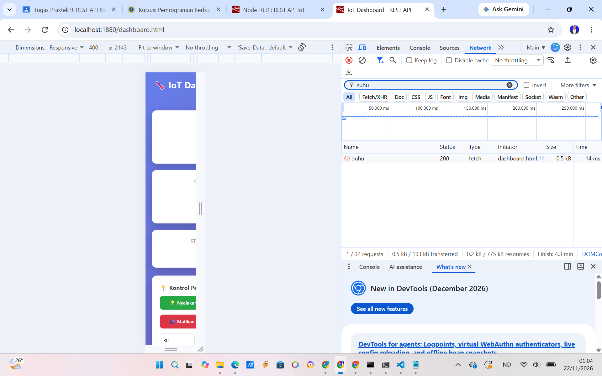
*Dengan filter `suhu`, hanya terdapat 1 request saat halaman dibuka. Setelah itu data suhu diterima melalui WebSocket sehingga tidak ada polling berulang.*

### 5. Penyimpanan History ke Database SQLite

**Penjelasan:** Pada awalnya history disimpan di flow context (memori), sehingga hilang saat Node-RED di-restart. Dengan SQLite, setiap data sensor ditulis ke file database `iot.db` (tabel `sensor` berisi `id`, `suhu`, `kelembaban`, dan `waktu`). Endpoint `/api/history` kemudian membaca 50 data terakhir dari database, sehingga data tetap tersedia meskipun sistem dimatikan lalu dinyalakan kembali.

*Node `timestamp` → `Create Table` digunakan untuk membuat tabel (cukup satu kali), kemudian node `Insert Sensor` menyimpan setiap data sensor ke `C:/node-red-data/iot.db`.*

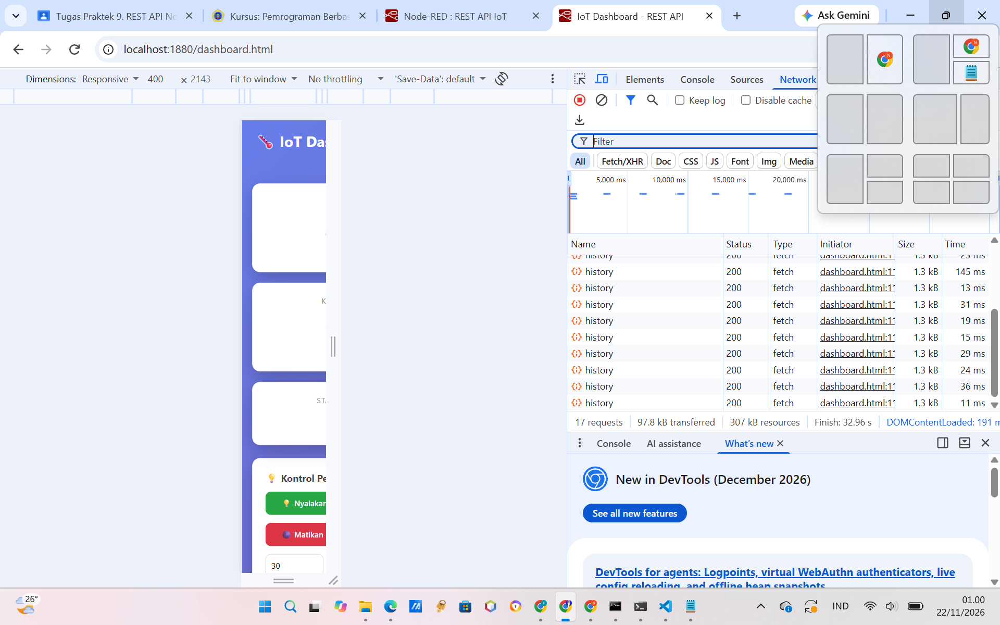
*Dashboard membaca `/api/history` dan menerima respons 200 yang berisi data dari database.*

Pengujian juga dilakukan dengan me-restart Node-RED. Setelah dinyalakan kembali, endpoint `/api/history` tetap mengembalikan data sebelum restart karena data tersimpan pada file `iot.db`.

---

## Daftar Endpoint

| Endpoint | Method | Fungsi |
|---|---|---|
| `/api/suhu` | GET | Data sensor terakhir |
| `/api/history` | GET | 50 data sensor terakhir (dari SQLite) |
| `/api/kontrol` | POST | Mengirim perintah ke perangkat |
| `/api/threshold` | PUT | Mengatur batas suhu untuk alert |
| `/ws/sensor` | WebSocket | Stream data sensor real-time |

Seluruh endpoint `/api/*` memerlukan header `X-API-Key`.

## Isi Repositori

- `flows.json`: flow Node-RED
- `dashboard.html`: dashboard web
- `simulasi_esp32.py`: simulator ESP32
- `screenshots/`: dokumentasi hasil pengerjaan
